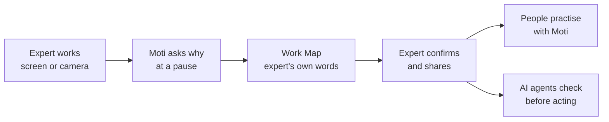
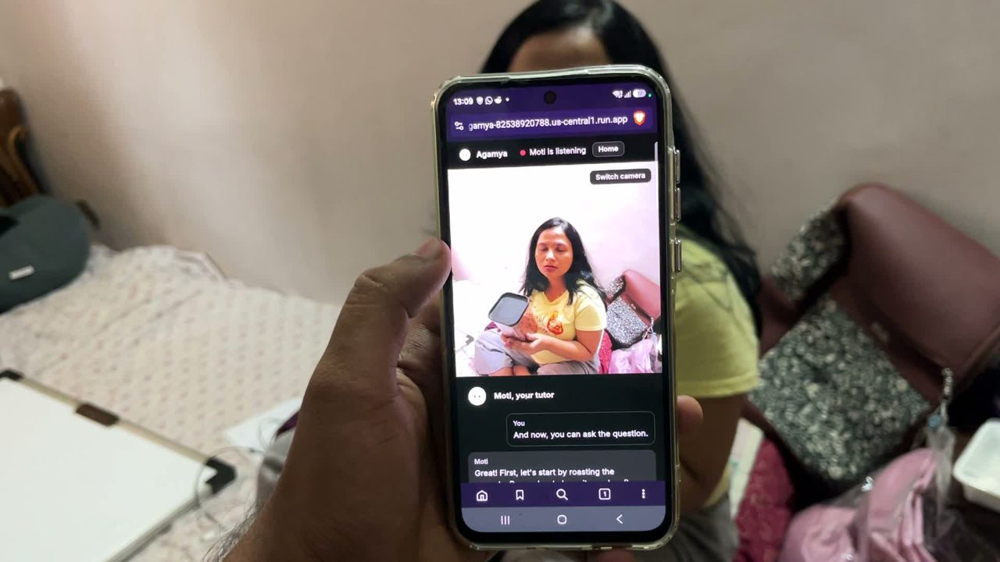

# Agamya

**Show it once. Confirm it. Pass it on, without losing why.**

Agamya captures the judgment experts carry in their heads and hands, and passes it on to people and to AI agents, with the reason and in the expert's own words.


| | |
|---|---|
| **Live app** | https://agamya-82538920788.us-central1.run.app |
| **Judges' guide** (every feature, with screenshots) | [docs/JUDGES_GUIDE.md](docs/JUDGES_GUIDE.md) |
| **Demo video** | *link* |
| **Our inspiration** (the story behind Agamya, with sources) | https://agamya-82538920788.us-central1.run.app/#/inspiration |
| **Pitch deck** | [PDF](docs/submission/Agamya-Submission-Deck.pdf) · [PPTX](docs/submission/Agamya-Submission-Deck.pptx) · [sources](docs/submission/RESEARCH_LEDGER.md) |

**Judge sign-in** (on the sign-in page, one click fills these in):

| Space | Email | Password |
|---|---|---|
| Agamya for Work | `judge.work@agamya.example` | `agamya-judges-2026` |
| Agamya for Culture | `judge.culture@agamya.example` | `agamya-judges-2026` |

---

## How it works



1. **Capture.** The expert shares their screen (Work) or camera (Culture) and works as usual. **Moti**, a live Gemini agent, watches, listens, and asks one short question at a natural pause.
2. **Work Map.** Steps, decisions, the reason in the expert's own words, and guardrails (when to stop, when to ask, what never to do). A quote the expert didn't say is labelled *AI-inferred*.
3. **Confirm.** A short debrief, then the expert confirms it and chooses who learns from it.
4. **Pass it on.**
   - People practise on camera or screen, and Moti stops a wrong decision: "Asha would stop here. Why?"
   - They can listen to the lesson in 15 languages, or ask questions.
   - **AI agents** ask the same map "would the expert stop here?" through REST, MCP or a Google ADK agent.

**In real use**

| Work: a handover before leave | Culture: a recipe in Marathi | Practice with Moti |
|---|---|---|
|  |  |  |

**In the app**

| Capture | Work Map | Practice | AI agent |
|---|---|---|---|
|  |  |  |  |

---

## Built with Google Cloud

| | Used for |
|---|---|
| **Gemini Live API** | Moti: sees, listens, asks and tutors, by voice, in Marathi, Hindi, Kannada and English |
| **Gemini 2.5 Flash** | Work Maps, tutor decisions, agent checks, Ask, narration scripts |
| **Gemini TTS** | Work Map narration in 15 languages |
| **Vertex AI Agent Engine + ADK** | The Guardian agent that stops where the expert would stop |
| **Cloud Run** | App, live WebSocket relay, job worker, agent API |
| **Cloud SQL · Cloud Storage · Secret Manager** | Data with per-space isolation, media, secrets |

Details: [Architecture](docs/ARCHITECTURE.md) · [AI agents](docs/AGENTS.md) · [Security and privacy](docs/SECURITY.md)

---

## Evidence

- **Tests:** 176 automated tests pass. All 22 end-to-end checks pass on the live app. Tested on iPhone.
- **Work Maps on 25 real recipes (YouCook2):** 100% of steps covered, no invented evidence, and every unspoken quote caught.
- **Personal data masked before storage:** email 100%, IBAN 99.9%, ID 99.9%, phone 94.6%.
- **Speed:** Moti asks about 2 s after the expert pauses, and the tutor stops a mistake in about 1.6 s.

Details: [Evaluation](docs/EVALUATION.md)

---

## Run it

```bash
npm install
cp .env.example .env     # set GOOGLE_CLOUD_PROJECT, then: gcloud auth application-default login
npm start                # http://localhost:3200
npm test                 # 176 tests
npm run deploy           # Cloud Run (PROJECT=<your-project>)
```

Without Google Cloud credentials the app still runs: AI features say "AI offline", and sessions can be typed.

## Repository

```
src/       server: product logic (domain), Gemini (ai), database and security (platform)
public/    web app (plain JavaScript, no build step)
agents/    Google ADK Guardian agent + Agent Engine deploy
tests/     automated tests
scripts/   deploy, evaluations, benchmarks
docs/      judges' guide, architecture, evaluation, security, pitch deck, images
```

## Limits

- Phones can't share their screen from a browser; use the camera there.
- Narration in languages other than English, Hindi, Marathi and Kannada is not yet reviewed by native speakers.
- A practice result shows practice, not certification.

## License

[MIT](LICENSE)
