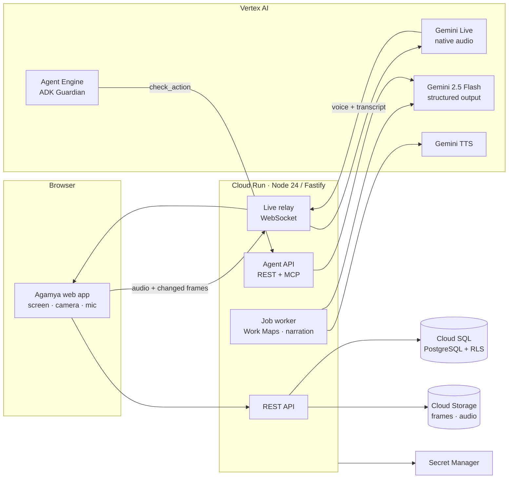
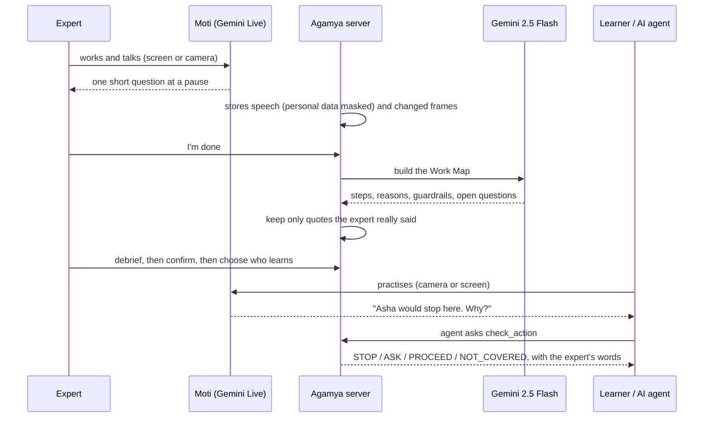

# Architecture

## One picture

## What each Google service does, and why

| Service | Used for | Why this one |
|---|---|---|
| **Gemini Live** (`gemini-live-2.5-flash-native-audio`, Vertex AI) | Moti: watches, listens, asks at a pause, tutors | Real voice conversation with vision. Session resumption and context compression keep long sessions alive. |
| **Gemini 2.5 Flash** (Vertex AI) | Builds the Work Map, decides tutor stops, checks agent actions, answers Ask, writes narrations | Fast, cheap, JSON schema output. Every answer is checked in code afterwards. |
| **Gemini TTS** | Work Map narration in 15 languages | Natural voice in Indian and other languages |
| **Vertex AI Agent Engine + Google ADK** | The Guardian agent that stops where the expert would stop | Managed hosting for agents, with tracing |
| **Cloud Run** | The whole app: API, live WebSocket relay, job worker, agent API | Scales to zero. A 1-hour request timeout and session affinity suit live sessions. |
| **Cloud SQL (PostgreSQL 16)** | All records, with Row-Level Security per space | The database itself enforces tenant isolation |
| **Cloud Storage** | Changed screen and camera frames, audio, narration audio | Private bucket with no public access, content-addressed (duplicates stored once) |
| **Secret Manager** | Database URL, salts, the agent key | No secrets in code or images |
| **Cloud Build + Artifact Registry** | Builds the container | One command deploys: `npm run deploy` |

## How a session flows

## Rules the code enforces

- **Grounding.** A quote is shown as the expert's only if it appears word for word in what they said. Otherwise it is labelled "AI-inferred". An agent verdict must point to a real guardrail of a confirmed map, or it becomes NOT_COVERED.
- **Isolation.** Every query runs under PostgreSQL Row-Level Security for the active space. Optional space passcode.
- **Access.** The expert sees their own maps. Owners, admins and coordinators see everything in the space. Others see confirmed maps shared with the space, a group, or them.
- **Privacy.** Consent before capture, and "off the record" at any time. Emails, phone numbers, card and ID numbers are masked before storage. Frames are sent only when the picture changes.
- **Cost control.** Changed frames only, context compression, cached narrations and answers, and a per-space AI budget. Every AI call is logged with its tokens and cost.

## Code map

| Folder | What is in it |
|---|---|
| `src/domain/` | Product logic: `live` (relay), `workmaps`, `agents`, `access`, `impact`, `identity`, `capture`, … |
| `src/ai/` | Gemini adapters and prompts (`ops/workmap.mjs`: map, tutor judge, agent check, narration) |
| `src/platform/` | Database, migrations, storage, security, redaction, jobs |
| `public/` | The web app (plain JavaScript modules, no build step) |
| `agents/guardrail_agent/` | The Google ADK agent and its Agent Engine deploy script |
| `tests/` | 176 automated tests (real HTTP and PostgreSQL; Gemini scripted) |
| `scripts/` | Deploy, evaluations, benchmarks |
