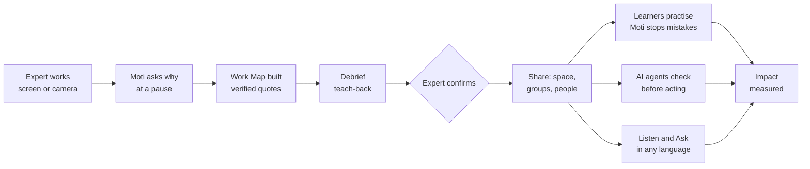

# Agamya: pitch deck content

Slide by slide, in the order of the challenge template. Screenshots are in `docs/images/`.

---

## 1. The idea

**Agamya** (Sanskrit: *hard to reach*) captures the judgment experts carry in their heads and hands, and passes it on with the reason, not just the steps.

An expert works as usual: sharing their screen, or on camera for crafts. **Moti**, a live Gemini agent, watches and listens, and asks one short question at the right moment. Agamya turns the session into a **Work Map**:
- every step, decision and reason in the expert's own words;
- the guardrails: when to stop, when to ask, what never to do.

Then:
- **People** practise with Moti as their tutor, in their own language. Moti stops them before a wrong decision.
- **AI agents** ask the same map "would the expert stop here?" before they act.

> One line: *Show it once. Confirm it. Pass it on, without losing why.*

Image: `01-landing.png`

---

## 2. Opportunity

**The problem**
- When an expert leaves, retires or is simply busy, the "why" leaves with them. Documents keep the steps, not the judgment: *"anything over ₹50,000 I hold for the controller, because last year a duplicate payment went out."*
- New hires learn by watching and interrupting seniors, which is slow and inconsistent.
- AI agents now act on business processes, but they do not know an organization's unwritten stop rules.
- Crafts, recipes and languages (Kathak footwork, Bengal weaving, a grandmother's recipe) are lost because no one recorded the *reasons*.

**How Agamya is different**

| Others | Agamya |
|---|---|
| Screen recorders and SOP writers record **what** was clicked | captures **why**, by asking at the right moment, live |
| Chatbots answer from documents, and may invent | every reason is the expert's **verified quote**, or labelled "AI-inferred" |
| Training is a video to watch | **practice** with a tutor that stops you before a mistake |
| Agent guardrails are hand-written prompts | guardrails come **from the expert**, confirmed by them, and are machine-checkable (REST and MCP) |
| English-first | Moti asks and teaches in **Marathi, Hindi, Kannada**, and more (narration in 15 languages) |

**How it solves it:** capture → understand → confirm → transfer, in one loop that takes minutes of the expert's time.

**USP:** the expert's confirmed judgment, in their own words, becomes three things:
- a lesson for people;
- a live tutor;
- a guardrail for AI agents.

---

## 3. Features

1. **Live capture with Moti (Gemini Live).** Screen or camera with voice. Moti asks at natural pauses, 3–5 times per 10 minutes, with at least one guardrail question. Off the record at any time.
2. **Work Map.** Steps, the screen moment, the decision, the reason in the expert's words, guardrails and open questions. Verified quotes only.
3. **Debrief and confirm.** Moti asks what is unclear and explains it back. The expert confirms ("approve"), then chooses who learns from it.
4. **Practice with a tutor.** Camera (also on phones) or screen. Moti stops a wrong decision ("Asha would stop here. Why?") and replays the expert's moment.
5. **Listen.** The Work Map as a spoken lesson in 15 languages.
6. **Ask.** Answers only from confirmed, shared Work Maps, quoting the expert.
7. **AI Guardian.** STOP / ASK / PROCEED / NOT_COVERED for any proposed action, through REST, MCP or the Google ADK agent on Vertex AI Agent Engine.
8. **Spaces, roles and sharing.**
   - Work and Culture spaces, with owner, admin, coordinator, expert and learner roles.
   - Share with everyone in the space, groups or people.
   - Request and grant access; remove people; optional space passcode.
9. **Impact.** Measured from records: expert minutes, questions, maps, mistakes stopped, agent checks, languages and AI cost.
10. **Trust.** Consent, masking of personal data, per-space isolation, accessibility (WCAG 2.2 AA target), and judge accounts for evaluation.

---

## 4. Process flow

**Use cases**
- **Work:** accounts payable, IT runbooks, customer escalations, a retiring specialist's judgment.
- **Culture:** a Kathak guru's footwork, a weaver's loom settings, a family recipe taught in Marathi to a grandchild who speaks English.

---

## 5. Wireframes / mock-ups

Use the real screens: `04-consent.png` → `05-live-capture.png` → `07-work-map.png` → `09-who-should-learn.png` → `13-tutor-stops.png`.

---

## 6. Architecture

Copy the diagram in [ARCHITECTURE.md](ARCHITECTURE.md) ("One picture").

- **Browser:** screen, camera and mic. Only changed frames are sent, at most 1 per second.
- **Cloud Run:** the API, the Gemini Live WebSocket relay, the job worker and the agent API (REST + MCP).
- **Vertex AI:**
  - Gemini Live (native audio);
  - Gemini 2.5 Flash (structured output);
  - Gemini TTS;
  - Agent Engine (Google ADK Guardian).
- **Data:**
  - Cloud SQL PostgreSQL with Row-Level Security per space;
  - Cloud Storage for frames and audio;
  - Secret Manager for secrets.

---

## 7. Technologies

| Google | Other |
|---|---|
| Gemini Live API (`gemini-live-2.5-flash-native-audio`) | Node.js 24, Fastify |
| Gemini 2.5 Flash, Gemini TTS, text-embedding-005 | PostgreSQL 16 (Row-Level Security) |
| Vertex AI Agent Engine + Agent Development Kit (ADK) | Model Context Protocol (MCP) |
| Cloud Run (WebSockets, 1 h timeout, session affinity) | Web Audio (AudioWorklet), WebRTC media capture |
| Cloud SQL, Cloud Storage, Secret Manager | axe-core accessibility checks |
| Cloud Build, Artifact Registry, Cloud Logging | Playwright (screenshots) |

---

## 8. Estimated cost

AI costs are recorded per call in the app, at list prices.

| Item | Cost |
|---|---|
| Build one Work Map (Gemini 2.5 Flash) | about **$0.005** (measured: 50 builds, $0.23) |
| 10-minute live capture with Moti (Gemini Live audio + changed frames) | about **$0.10–0.20** |
| Spoken narration of a map, per language (cached) | about **$0.01** |
| One agent check | under **$0.001** |
| Cloud Run | scales to zero; pay per use |
| Cloud SQL (db-f1-micro) + Storage | about **$10–15 / month** for a pilot |

**Example:** one expert, 20 workflows, about 30 minutes each, comes to **under $15 of AI** for a fully mapped role.

---

## 9. Snapshots

| File | Shows |
|---|---|
| `01-landing.png` | Landing: Agamya for Work and for Culture |
| `05-live-capture.png` | Moti asks a guardrail question during screen capture |
| `07-work-map.png`, `08-screen-moment.png` | Work Map with screen moments and verified quotes |
| `09-who-should-learn.png` | Confirm, then choose who learns |
| `10-listen-hindi.png` | Spoken lesson in Hindi |
| `11-would-asha-stop.png` | Agent check: STOP with the expert's words |
| `13-tutor-stops.png` | Tutor stops a wrong decision (Hindi) |
| `15-impact.png` | Impact, measured |
| `18-learning.png`, `20-inbox-request.png` | Learning, request access, grant |
| `22-space-locked.png` | Optional space passcode |
| `26-culture-live-marathi.png` | Culture: Moti asks in Marathi on camera |

---

## 10. Performance and benchmarks

Detail: [EVALUATION.md](EVALUATION.md).

| Measure | Result |
|---|---|
| Moti asks after the expert pauses | about **2 s** |
| Tutor stops a wrong decision | about **1.6 s** (Hindi, Kannada, English) |
| Work Map on 25 real recipes (YouCook2) | **100%** steps covered, **0%** invented evidence, **100%** in order |
| Quotes not said by the expert | **caught every time** (labelled AI-inferred) |
| Personal-data masking (43,501 sentences) | email 100%, IBAN 99.9%, ID 99.9%, phone 94.6%; amounts and dates untouched |
| Automated tests | **176 / 176** |
| End-to-end on the deployed app | **22 / 22** |
| Phones | tested on iPhone (camera practice, voice) |

---

## 11. Future development

- **Two experts on one map:** show where they agree, where they differ, and why.
- **More languages reviewed** by native speakers (narration already supports 15).
- **Connectors:** export guardrails to agent platforms and RPA tools.
- **Single sign-on with Google Workspace**, and directory groups.
- **On-device masking** of faces and screens before upload.
- **Culture archive:** opt-in public collections of crafts, with the community's consent.

---

## 12. Links

| | |
|---|---|
| GitHub (public) | https://github.com/S-D-P/Agamya-AI-Builder-Cup-26 |
| Demo video (3 min) | *add link* |
| Live product | https://agamya-82538920788.us-central1.run.app |
| Judge sign-in | Work `judge.work@agamya.example` · Culture `judge.culture@agamya.example` · password `agamya-judges-2026` |

---

## Brief description (for the submission form)

> **Agamya** captures expert judgment, the *why* behind the work, and passes it on to people and AI agents.
>
> **How it works**
> - An expert works as usual, sharing their screen or on camera, while **Moti**, a live **Gemini Live API** agent, watches, listens and asks one short question at the right moment.
> - **Gemini 2.5 Flash** turns the session into a **Work Map**: steps, decisions, reasons in the expert's own (verified) words, and guardrails.
> - The expert confirms it and chooses who learns from it.
> - Learners **practise** with Moti as a live tutor in Hindi, Marathi, Kannada or English, and Moti stops a wrong decision before it happens.
> - **Gemini TTS** narrates the map in 15 languages.
> - AI agents ask the same map **"would the expert stop here?"** through REST, **MCP**, or a **Google ADK** agent deployed on **Vertex AI Agent Engine**.
>
> **Built on Google Cloud**
> - **Cloud Run:** API, Gemini Live WebSocket relay and job worker.
> - **Cloud SQL (PostgreSQL)** with Row-Level Security for isolating spaces.
> - **Cloud Storage** for frames and audio; **Secret Manager** for secrets; **Cloud Build** for deploys.
>
> **Evidence:** 176 automated tests; evaluated on public datasets (YouCook2, ai4privacy); tested live on desktop and iPhone.
